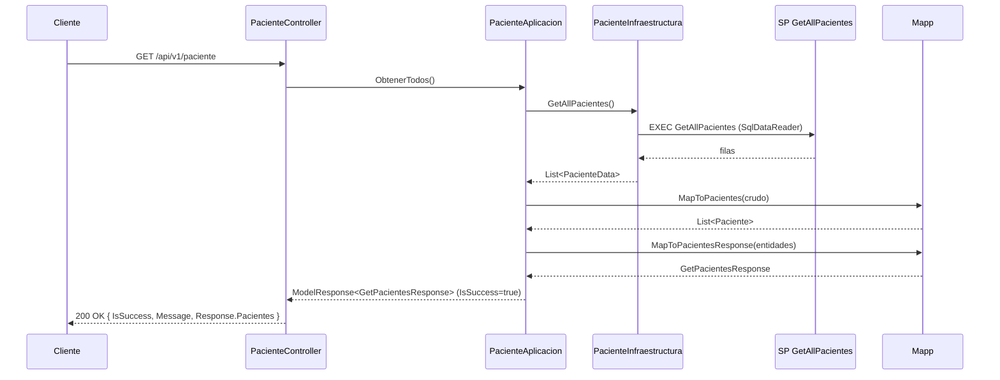
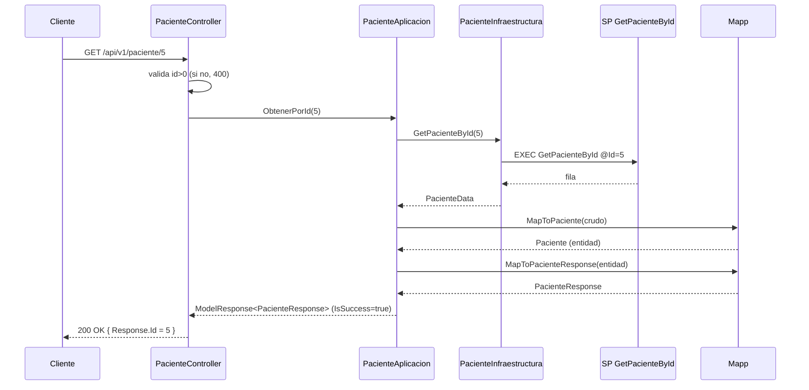
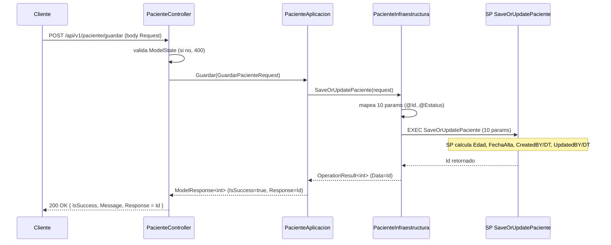
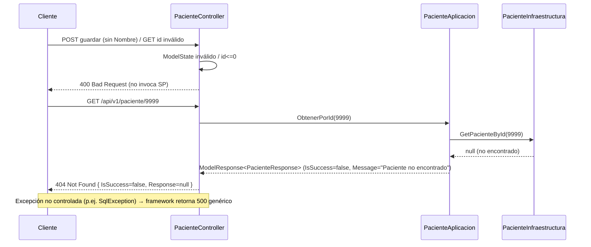

# Diseño Técnico: Dominio Paciente

## Enfoque Técnico

Fase 1 **greenfield**: se crea la solución `DESI.ConsultorioMedico.sln` y únicamente el dominio **Paciente** (5 proyectos por capa) más los proyectos **Common.\*** de soporte y la **WebApi**. Acceso a datos **ADO.NET estricto** (`SqlConnection`/`SqlCommand`/`SqlDataReader`), sin ORM. Flujo canónico: `Controller → Aplicacion → Infraestructura (ADO.NET → SP) → Mapp → entidad/DTO → ModelResponse<T>`. Los errores se manejan en el Controller (sin middleware global). Fuente de verdad: `espesificaciones3.md` prevalece sobre las anteriores.

## Estructura de la Solución y Referencias

```
DESI.ConsultorioMedico.sln
├── Paciente/
│   ├── Paciente.Dominio         (DESI.ConsultorioMedico.Paciente.Dominio)
│   ├── Paciente.Aplicacion      (DESI.ConsultorioMedico.Paciente.Aplicacion)
│   ├── Paciente.Infraestructura (DESI.ConsultorioMedico.Paciente.Infraestructura)
│   ├── Paciente.Mensajes        (DESI.ConsultorioMedico.Paciente.Mensajes)
│   └── Paciente.Pruebas         (xUnit)
├── Common/
│   ├── Common.Data
│   ├── Common.Http
│   ├── Common.Helpers
│   └── Common.Mensajes
└── ConsultorioMedicoWebApi      (ASP.NET Core Web API)
```

**Referencias de proyecto (quién referencia a quién):**

```
Paciente.Dominio ── (sin referencias; dominio puro)
        ▲
        ├── Paciente.Mensajes ──────────────→ Paciente.Dominio
        │        ▲
        │        ├── Paciente.Infraestructura → {Paciente.Dominio, Paciente.Mensajes, Common.Data, Common.Mensajes}
        │        └── Paciente.Aplicacion      → {Paciente.Infraestructura, Paciente.Dominio, Paciente.Mensajes, Common.Mensajes}
        │                 ▲
        │                 └── ConsultorioMedicoWebApi → {Aplicacion, Infraestructura, Mensajes, Dominio, Common.*}
Common.Data ── (solo Microsoft.Data.SqlClient)
Common.Mensajes ── (sin referencias)
Paciente.Pruebas ── {Dominio, Aplicacion, Mensajes, Common.Mensajes}
```

Punto clave: **Aplicacion referencia Infraestructura** — depende de la abstracción `IPacienteRepository` (definida en Infraestructura); la implementación concreta se resuelve por DI en WebApi. Infraestructura abstrae cualquier origen de datos (SQL hoy, HTTP en el futuro) detrás del contrato de repositorio.

## Responsabilidades por Proyecto

### Paciente.Dominio
| Clase | Tipo | Responsabilidad |
|-------|------|-----------------|
| `Entity<T>` | abstracta | Base con `Id` de solo lectura (getter protegido). |
| `Paciente` | entidad | Factory Method (`Paciente.Create()`, ctor privado) + Fluent Interface (`Set…` retornan `this`); propiedades solo lectura; cada `Set` valida y lanza `ArgumentException`. |
| `Email`, `Telefono`, `Sexo` | Value Objects | Encapsulan/validan sus reglas. `Sexo` es string (no enum). |

### Paciente.Mensajes
| Clase | Tipo | Responsabilidad |
|-------|------|-----------------|
| `GuardarPacienteRequest` | DTO entrada | 10 campos con DataAnnotations. |
| `PacienteResponse` | DTO salida | Incluye `NombreCompleto` compuesto. |
| `GetPacientesResponse` | DTO salida | `{ Pacientes: List<PacienteResponse> }` (sin OperationResult). |
| `PacienteData` | DTO crudo | Registro plano mapeado desde `SqlDataReader` (todas las columnas del SP). |
| `Mapp` | estática | Mapeo crudo→entidad y entidad→response. |

### Paciente.Aplicacion
| Clase | Tipo | Responsabilidad |
|-------|------|-----------------|
| `IPacienteAplicacion` | interfaz | `ObtenerTodos()`, `ObtenerPorId(int)`, `Guardar(GuardarPacienteRequest)`. |
| `PacienteAplicacion` | servicio | Orquesta Infraestructura→Mapp; arma `ModelResponse<T>` con mensajes de `SystemMessage`. |

### Paciente.Infraestructura
| Clase | Tipo | Responsabilidad |
|-------|------|-----------------|
| `IPacienteRepository` | interfaz | Contrato del repositorio (GetAll/GetById/SaveOrUpdate); vive aquí para abstraer cualquier origen de datos (SQL hoy, HTTP futuro). |
| `PacienteInfraestructura` | implementación | Hereda `BaseRepository`, implementa `IPacienteRepository`; ejecuta los 3 SPs; devuelve datos crudos (sin lógica de negocio). |

### Common.Data
| Clase | Tipo | Responsabilidad |
|-------|------|-----------------|
| `BaseRepository` | abstracta | `GetConnection()`, `ExecuteReaderAsync<T>()`, `ExecuteNonQueryAsync()`; lee cadena de conexión de `IConfiguration`. |
| `ConnectionHelper` | helper | Construye `SqlConnection` desde `DefaultConnection`. |
| `SqlDataReaderExtensions` | extensión | Lectores tipados seguros (`GetStringSafe`, `GetInt32Safe`, `GetDateTimeSafe`, `GetBoolSafe`; manejan `DBNull`). |

### Common.Mensajes
| Clase | Tipo | Responsabilidad |
|-------|------|-----------------|
| `ModelResponse<T>` | sobre público | `{ IsSuccess, Message, Response }`. |
| `OperationResult` / `OperationResult<T>` | resultado interno | `{ IsSuccess, Message, Data }` para capas Aplicacion/Infraestructura. |
| `SystemMessage` / `SystemMessageTypes` | catálogo | Mensajes en español ("Pacientes obtenidos correctamente", "Paciente no encontrado", "Paciente creado exitosamente", "Paciente actualizado exitosamente"). |

### ConsultorioMedicoWebApi
| Clase | Tipo | Responsabilidad |
|-------|------|-----------------|
| `PacienteController` | controller | 3 endpoints; valida `ModelState`; mapea a códigos HTTP 200/400/404; retorna `ModelResponse<T>`. |
| `Program.cs` | bootstrap | DI, Serilog, CORS, Rate Limiting, Scalar. |

## Decisiones de Arquitectura (ADR)

| # | Decisión | Opción elegida | Alternativas descartadas | Racional |
|---|----------|----------------|--------------------------|----------|
| ADR-1 | Capas por dominio (5 proyectos) + Common + WebApi | Estructura de la solución arriba | Monolito único / capas globales | Coincide con especificaciones; escala a dominios futuros (Usuario, Cita…) sin reestructurar. |
| ADR-2 | Acceso a datos | ADO.NET estricto (`SqlConnection`/`SqlCommand`/`SqlDataReader`) vía `BaseRepository` | EF Core, Dapper | Requisito explícito; control total sobre SPs y mapeo. |
| ADR-3 | Firma `SaveOrUpdatePaciente` | **10 parámetros** (solo campos Request) | 16 parámetros de `espesificaciones3.md` §14.3 | Decisión consolidada: `Edad`, `FechaAlta`, `CreatedBY/DT`, `UpdatedBY/DT` los calcula/rellena el SP. |
| ADR-4 | `Sexo` | string con VO validado ("Masculino"/"Femenino") | enum | `espesificaciones3.md` §17.1; evita conversiones con BD. |
| ADR-5 | Envelope | `ModelResponse<T>` público; `OperationResult` interno | Un solo tipo para todo | `OperationResult` vive en Aplicacion/Infraestructura; `ModelResponse` es lo único que ve el cliente. `GetPacientesResponse` no embebe `OperationResult` (redundante). |
| ADR-6 | Nombrado y ubicación de repositorio | Contrato `IPacienteRepository` (Infraestructura) + implementación `PacienteInfraestructura` | Contrato en Dominio o Aplicacion | El repositorio vive en Infraestructura para abstraer cualquier origen de datos (SQL hoy, HTTP futuro); `Aplicacion` depende de la abstracción vía DI. |
| ADR-7 | Dependencias | `Infraestructura → Mensajes → Dominio` (datos crudos `PacienteData` en Mensajes) | Mensajes → Infraestructura | `Mapp` (Mensajes) mapea crudo→entidad sin referenciar Infraestructura; evita ciclo. |
| ADR-8 | Orden de `GetAllPacientes` | Lo define el SP | `ORDER BY` en código | Decisión consolidada; la app no ordena. |
| ADR-9 | Manejo de errores | Nivel Controller | Middleware global | Requisito: 400 (`ModelState`), 404 (no encontrado), 500 genérico del framework. |
| ADR-10 | Base `Entity<T>` | En `Paciente.Dominio` | En Common | Fase 1; promovible a `Common.Domain` al agregar más dominios. |

## Diagramas de Secuencia

### 1. GET /api/v1/paciente (obtener todos)



### 2. GET /api/v1/paciente/{id} (encontrado)



### 3. POST /api/v1/paciente/guardar (crear/actualizar)



### 4. Flujo de error (validación 400 / no encontrado 404 / no controlado 500)



## Diseño de Acceso a Datos (ADO.NET)

- **Conexión**: `BaseRepository` inyecta `IConfiguration`; `ConnectionHelper` construye `SqlConnection` con `ConnectionStrings:DefaultConnection`. Cada operación abre/cierra conexión con `using` + `OpenAsync()` (no se comparte conexión).
- **Lectura**: `ExecuteReaderAsync<T>(nombreSP, CommandType.StoredProcedure, Func<SqlDataReader,T> mapper, params SqlParameter[])` itera el reader y delega el mapeo columna→objeto al mapper (que usa `SqlDataReaderExtensions` para leer con seguridad ante `DBNull`).
- **Escritura**: `ExecuteNonQueryAsync(nombreSP, params SqlParameter[])` ejecuta el SP y lee el valor de retorno (`RETURN`/`OUTPUT`) para obtener el Id.
- **Parámetros**: `SqlParameter` tipados (`SqlDbType`); valores nulos como `DBNull.Value` (`(object?)value ?? DBNull.Value`); `CommandType.StoredProcedure`; `CommandTimeout` configurable.
- **Mapeo de `SaveOrUpdatePaciente`** (10 params, ADR-3): `@Id, @Nombre, @ApellidoPaterno, @ApellidoMaterno, @Email, @TelefonoCel, @Comentarios, @Sexo, @FechaNacimiento, @Estatus`. `Edad`, `FechaAlta` y auditoría los calcula el SP.

## Estrategia de Mapeo (Mapp)

Clase `public static class Mapp` en `Paciente.Mensajes`, con métodos explícitos `MapXToY()`:

| Método | Entrada → Salida | Detalle |
|--------|------------------|---------|
| `MapToPaciente(PacienteData)` | crudo → `Paciente` | Usa Fluent: `Paciente.Create().SetId(…).SetNombre(…).SetEmail(new Email(…))…` |
| `MapToPacientes(IEnumerable<PacienteData>)` | crudo → `List<Paciente>` | Proyección del anterior. |
| `MapToPacienteResponse(Paciente)` | entidad → `PacienteResponse` | `NombreCompleto = $"{Nombre} {ApellidoPaterno} {ApellidoMaterno}".Trim()`; extrae string de los VOs. |
| `MapToPacientesResponse(List<Paciente>)` | entidades → `GetPacientesResponse` | `{ Pacientes = … }`. |

La entidad se construye en el flujo de **lectura** (ejercita validación Fluent/Factory). El flujo de **guardado** no hace ida y vuelta por entidad: el Request validado va directo a parámetros del SP (el SP es dueño de `Edad`/auditoría).

## Sobre `ModelResponse<T>` y su relación con `OperationResult`

```csharp
public class ModelResponse<T> {
    public bool IsSuccess { get; set; }
    public string Message { get; set; }
    public T Response { get; set; }
}
```

- `ModelResponse<T>` es el **sobre público**: TODO endpoint lo retorna, y lo produce `PacienteAplicacion`.
- `OperationResult`/`OperationResult<T>` (`IsSuccess`, `Message`, `Data`) es el **resultado interno** entre Infraestructura y Aplicacion (p.ej. `SaveOrUpdatePaciente` retorna `OperationResult<int>` con el Id). Aplicacion lo traduce a `ModelResponse<T>` (copia `IsSuccess`/`Message`, `Data`→`Response`).
- `GetPacientesResponse` **no** embebe `OperationResult` (ADR-5): la señal de éxito ya vive en el sobre, evitando redundancia.
- Mensajes textuales provienen de `SystemMessage` (español), nunca hardcodeados en el Controller.

## Registro de Inyección de Dependencias (Program.cs)

```csharp
// Scoped por petición
builder.Services.AddScoped<IPacienteAplicacion, PacienteAplicacion>();
builder.Services.AddScoped<IPacienteRepository, PacienteInfraestructura>();

// Soporte
builder.Host.UseSerilog((ctx, cfg) => cfg.ReadFrom.Configuration(ctx.Configuration)); // Consola dev / Archivo prod
builder.Services.AddCors(o => o.AddPolicy("Abierta", p => p.AllowAnyOrigin().AllowAnyMethod().AllowAnyHeader()));
builder.Services.AddRateLimiter(o => o.AddFixedWindowLimiter("fixed", l => { l.PermitLimit = 100; l.Window = TimeSpan.FromMinutes(1); }));
builder.Services.AddControllers(); // + XmlComments para Scalar

// Pipeline
app.UseSerilogRequestLogging();
app.UseCors("Abierta");
app.UseRateLimiter();
app.MapControllers();
app.MapScalarApiReference(); // /scalar/v1
```

Notas: **JWT queda fuera** de Fase 1 (dominio Usuario). `appsettings.json` lleva `ConnectionStrings:DefaultConnection` y configuración de Serilog.

## Contratos / Interfaces

`IPacienteRepository` vive en `Paciente.Infraestructura`; `IPacienteAplicacion` vive en `Paciente.Aplicacion`.

```csharp
public interface IPacienteRepository {
    Task<List<PacienteData>> GetAllPacientes();
    Task<PacienteData?> GetPacienteById(int id);
    Task<OperationResult<int>> SaveOrUpdatePaciente(GuardarPacienteRequest request);
}

public interface IPacienteAplicacion {
    Task<ModelResponse<GetPacientesResponse>> ObtenerTodos();
    Task<ModelResponse<PacienteResponse>> ObtenerPorId(int id);
    Task<ModelResponse<int>> Guardar(GuardarPacienteRequest request);
}
```

## Estrategia de Pruebas

| Capa | Qué probar | Enfoque |
|------|-----------|---------|
| Unit (Dominio) | Fluent/Factory de `Paciente`; validaciones de `Email`/`Telefono`/`Sexo` | xUnit en `Paciente.Pruebas/Domain`. |
| Unit (Aplicacion) | Orquestación con `IPacienteRepository` falso (mock/stub) | xUnit en `Paciente.Pruebas/Application`; verifica `ModelResponse` (éxito, no encontrado, validación). |
| Unit (Mapp) | `MapToPaciente` / `MapToPacienteResponse` (incluye `NombreCompleto`) | xUnit en `Paciente.Pruebas`. |
| Integración (Infra) | Ejecución real de los 3 SPs contra BD | Postergado/no automatizado en Fase 1 (validación manual contra SPs reales). |

## Migración / Despliegue

Greenfield: sin migración de datos ni código previo que revertir. Rollback = descartar rama (`git reset --hard` / `git branch -D`); especificaciones intactas. Los SPs no se alteran sin script versionado.

## Preguntas Abiertas

- [ ] Confirmar firma real de `SaveOrUpdatePaciente` contra la BD de producción (¿10 parámetros o los 16 de `espesificaciones3.md` §14.3?) — ADR-3 asume 10.
- [ ] Confirmar tipos/nulabilidad exactos de columnas de `dbo.Paciente` al implementar los mapeos del reader.
- [ ] Confirmar si `GET /api/v1/paciente` debe retornar 200 también cuando la lista está vacía (el spec así lo define; sin estado 204).
